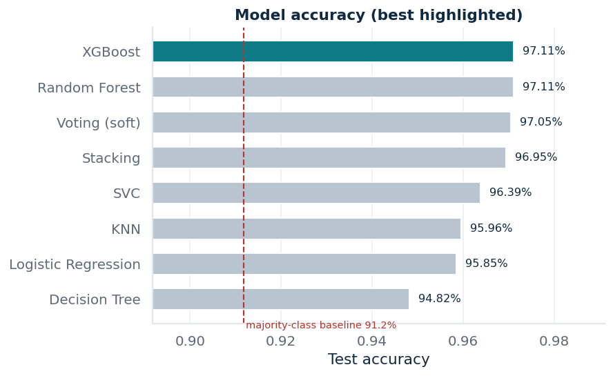
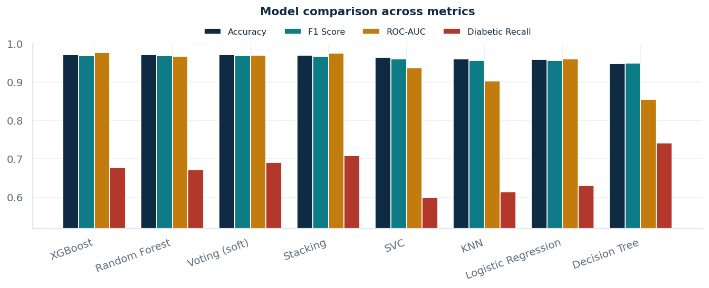
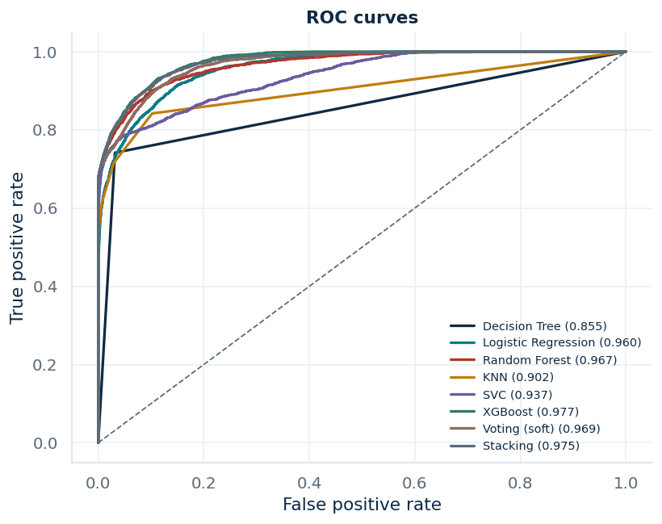
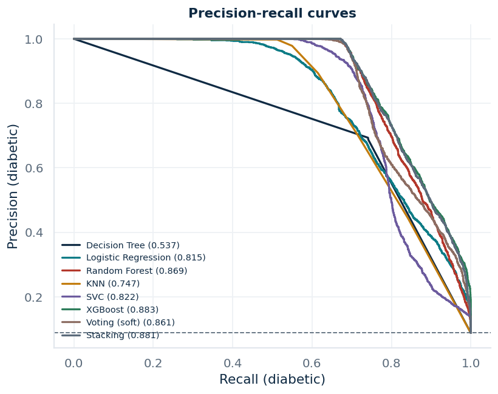
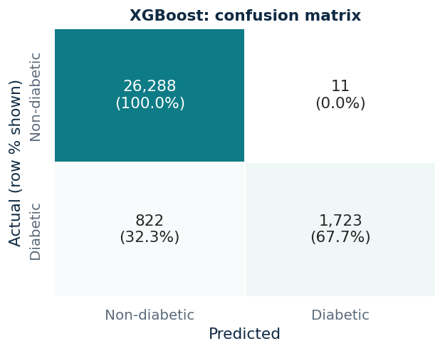
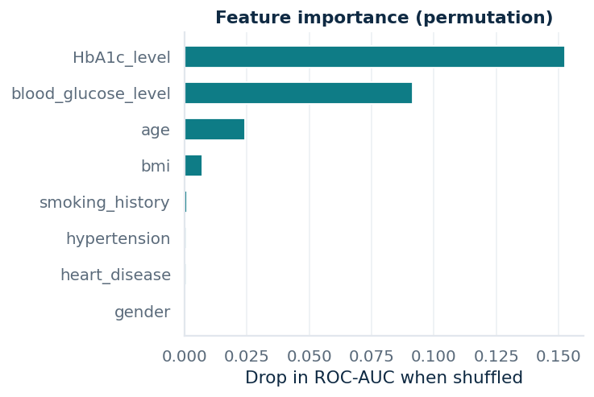

# Diabetes Risk Prediction

Machine-learning project that compares eight classifiers on the Kaggle *Diabetes Prediction Dataset*, selects the best performer automatically, and serves it through a Streamlit dashboard and a Gradio demo.

**Target variable:** `diabetes` (0 = non-diabetic, 1 = diabetic)

## Highlights
- Data cleaning: exact duplicate rows removed (3,854) to prevent train/test leakage
- Preprocessing inside a `ColumnTransformer`: one-hot encoding for categorical features, scaling for numeric features
- Eight models compared: Decision Tree, Logistic Regression, Random Forest, KNN, SVC, XGBoost, Voting, Stacking
- Automatic best-model selection (highest test accuracy, ties broken by weighted F1)
- Visual analysis: class balance, feature distributions, box plots, category-wise diabetes rate, correlation matrix, ROC and precision-recall curves, confusion matrix, permutation feature importance
- Streamlit dashboard: risk assessment, data explorer, model comparison, best-model analysis

## Results
Stratified 70/30 split (`random_state=42`): 67,302 training and 28,844 test records.

| Model | Accuracy | Precision | Recall | F1 | ROC-AUC | Diabetic Recall | Diabetic F1 |
|---|---|---|---|---|---|---|---|
| **XGBoost** | 0.9711 | 0.9718 | 0.9711 | 0.9686 | 0.9769 | 0.6770 | 0.8053 |
| Random Forest | 0.9711 | 0.9719 | 0.9711 | 0.9684 | 0.9668 | 0.6723 | 0.8039 |
| Voting (soft) | 0.9705 | 0.9704 | 0.9705 | 0.9683 | 0.9692 | 0.6916 | 0.8055 |
| Stacking | 0.9695 | 0.9685 | 0.9695 | 0.9676 | 0.9749 | 0.7092 | 0.8038 |
| SVC | 0.9639 | 0.9647 | 0.9639 | 0.9598 | 0.9373 | 0.5992 | 0.7454 |
| KNN | 0.9596 | 0.9576 | 0.9596 | 0.9561 | 0.9024 | 0.6149 | 0.7286 |
| Logistic Regression | 0.9585 | 0.9561 | 0.9585 | 0.9556 | 0.9597 | 0.6314 | 0.7288 |
| Decision Tree | 0.9482 | 0.9499 | 0.9482 | 0.9490 | 0.8549 | 0.7411 | 0.7164 |

Precision, Recall and F1 are class-weighted; Diabetic Recall and Diabetic F1 are for the positive class.

| | |
|---|---|
|  |  |
|  |  |
|  |  |

## How to read the accuracy
About 9% of records are diabetic, so a model that always predicts "non-diabetic" already scores **91.2%**. The best models reach about 97%, driven mainly by `HbA1c_level` and `blood_glucose_level`, the clinical measures that define diabetes. The weaker point is recall on the diabetic class (about 68% for the best model), so a screening use case would need a lower decision threshold.

## Project structure
```
├── B3_B4_57_diabetes_prediction.ipynb   # full analysis notebook (Colab friendly)
├── train.py                             # trains all models, saves artifacts/
├── model.py                             # data loading, pipelines, prediction helpers
├── plots.py                             # plotting helpers
├── streamlit_app.py                     # Streamlit dashboard
├── gradio_app.py                        # Gradio demo
├── diabetes_prediction_dataset.csv
├── artifacts/                           # best_model.joblib, summary.joblib
├── assets/                              # plots used in this README
└── requirements.txt
```

## Run locally
Python 3.11+ is recommended.
```bash
pip install -r requirements.txt
python train.py                 # optional: artifacts are already included
streamlit run streamlit_app.py
python gradio_app.py
```
The saved artifacts were created with the library versions pinned in `requirements.txt`; if you use different versions, run `python train.py` once to regenerate them.

## Disclaimer
Educational project. Not a medical device and not suitable for clinical decisions.

## Author
Rajveer Singh, B.Tech CSE (AI & Data Science)
